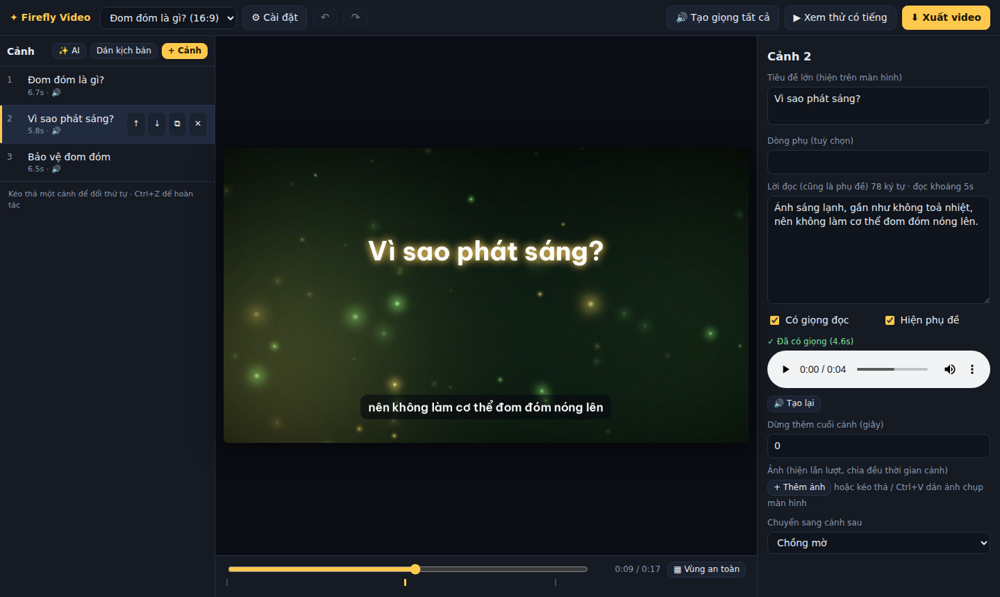

<h1 align="center">Firefly Video</h1>

Tool dựng video giải thích: nền động đom đóm/ánh sáng, giọng đọc Edge TTS (miễn phí, có giọng dự phòng),
thêm ảnh, chuyển cảnh, phụ đề tự chia câu, xuất tới 2K 60fps.

- Chạy hoàn toàn trên máy bạn, mở bằng trình duyệt; không cần cài FFmpeg riêng.
- 4 khung hình (9:16, 16:9, 1:1, 4:5) kèm vùng an toàn cho Reels/Shorts/TikTok.
- Có giọng dự phòng khi Edge TTS lỗi (Piper chạy offline, gTTS), chuẩn hoá âm lượng, hoàn tác/làm lại.
- Kịch bản AI là tuỳ chọn, chạy bằng Ollama trên máy bạn.

## Chạy
Cần Python 3.10 trở lên (hoặc dùng bản đóng gói bên dưới, không cần Python). Tool tự mở trình duyệt tại http://localhost:8765; không mở được (máy chủ, WSL, SSH…) thì in địa chỉ ra để bạn mở tay.
Không cần cài ffmpeg riêng (đã kèm qua `imageio-ffmpeg`; nếu máy đã có ffmpeg thì dùng cái đó).
- **Windows**: bấm đúp `run.bat`.
- **macOS**: bấm đúp `FireflyVideo.command` (mở trong Terminal; đóng cửa sổ Terminal là tắt tool). Lần đầu macOS có thể chặn vì file tải từ internet: bấm chuột phải → *Mở* → *Mở*.
  Chưa có Python 3.10+ thì cài bằng `brew install python` hoặc bản cài ở python.org.
- **Linux / WSL**: `./run.sh`. Muốn có biểu tượng trong menu ứng dụng để bấm một cú: `./install_linux_shortcut.sh` (thêm `--desktop` để có cả ngoài màn hình nền, `--remove` để gỡ).
  Ubuntu/Debian có thể cần `sudo apt install python3 python3-venv` trước.
- `run.sh` / `FireflyVideo.command` **tự tạo môi trường riêng `.venv`** cạnh `app.py` và cài thư viện vào đó (lần đầu cần internet, khoảng 1 phút; các lần sau khởi động dưới 1 giây vì chỉ cài lại khi `requirements.txt` đổi).
  Không đụng Python của hệ thống và không cần quyền quản trị; Python mới của Ubuntu/Debian/Homebrew từ chối `pip install` thẳng vào hệ thống nên tool dùng môi trường riêng. Muốn cài lại từ đầu thì xoá thư mục `.venv`.
- Biến môi trường: `PORT` (cổng, mặc định 8765; bận thì tự dùng cổng kế), `FFV_HOME` (nơi lưu dự án/nhật ký), `FFV_NO_BROWSER=1` (không tự mở trình duyệt).

### Bản đóng gói (.exe, không cần cài Python)
Chạy `build_exe.bat` (Windows) hoặc `./build_exe.sh` trên máy có Python, ra `dist/FireflyVideo/FireflyVideo.exe` kèm cả FFmpeg và font. Xem [docs/packaging.md](docs/packaging.md).

## Quy trình
1. **Dự án mới** → chọn khung hình (9:16, 16:9, 1:1, 4:5), chất lượng (720p/1080p/2K), fps (24/30/60), kiểu nền.
2. **Dán kịch bản**: mỗi đoạn cách nhau 1 dòng trống = 1 cảnh; dòng bắt đầu bằng `#` là tiêu đề hiện trên màn hình.
   Chưa có kịch bản thì bấm **✨ AI** để nhờ AI chạy trên máy bạn viết bản nháp (xem [docs/ai-script.md](docs/ai-script.md)).
3. Chọn từng cảnh để sửa: tiêu đề, lời đọc, ảnh (chọn file, kéo thả, hoặc Ctrl+V dán ảnh chụp màn hình),
   kiểu ảnh (thẻ nổi / vừa khung + nền mờ / toàn màn hình), hiệu ứng ảnh, bố cục chữ-ảnh (chuẩn / chia đôi), kiểu chuyển cảnh.
4. **Cài đặt**: giọng, tốc độ, từ điển phát âm (VD `GitHub=Ghít hấp`), nhạc nền, âm lượng cuối, logo, kiểu và màu nền động, bộ mã hoá.
5. **Tạo giọng tất cả** → kéo thanh thời gian xem từng khung → **Xem thử có tiếng** → **Xuất video**.

File xuất nằm ở `projects/<tên dự án>/out/`. Dự án tự lưu; tắt tool mở lại vẫn còn.

## Kiểm tra máy
- `python doctor.py` (hoặc **Cài đặt → Kiểm tra máy**) báo FFmpeg, các encoder CPU/GPU, font, kết nối dịch vụ giọng đọc, ổ đĩa.

## Giọng dự phòng
Edge TTS là endpoint không chính thức của Microsoft nên có thể ngừng hoạt động bất cứ lúc nào. Khi giọng chính lỗi, tool tự chuyển sang Piper (chạy offline trên máy) hoặc gTTS và vẫn dựng được video.
Cách cài Piper, thứ tự chọn giọng và biến môi trường `FFV_TTS`: xem [docs/tts.md](docs/tts.md).

## Tài liệu
- [docs/features.md](docs/features.md): xuất video, âm lượng, hình ảnh, hoàn tác, vùng an toàn, dọn file không dùng.
- [docs/tts.md](docs/tts.md): giọng đọc, phụ đề, giọng dự phòng (Piper, gTTS).
- [docs/ai-script.md](docs/ai-script.md): viết kịch bản bằng AI (Ollama).
- [docs/troubleshooting.md](docs/troubleshooting.md): nhật ký, bảng mã lỗi, file dự án hỏng, cổng bận.
- [docs/packaging.md](docs/packaging.md): đóng gói thành `.exe` / bản nhị phân.
- [docs/development.md](docs/development.md): cấu trúc mã giao diện, chạy test.

## Giấy phép và font
- Font chữ: Be Vietnam Pro (SIL OFL, trong thư mục `fonts/`).
- Giấy phép: mã nguồn của tool theo **MIT** (file `LICENSE`). Các thư viện và font đi kèm giữ giấy phép riêng của chúng (VD `edge-tts` là LGPL-3.0; font là SIL OFL).
  Bản FFmpeg do `imageio-ffmpeg` kèm theo là bản build GPL (`--enable-gpl`); tool chỉ gọi nó như chương trình riêng nên mã của tool vẫn là MIT, nhưng nếu bạn **phát hành lại bản đóng gói** (`dist/FireflyVideo/`, có chứa FFmpeg) thì phần FFmpeg phải theo điều kiện GPL của nó.
